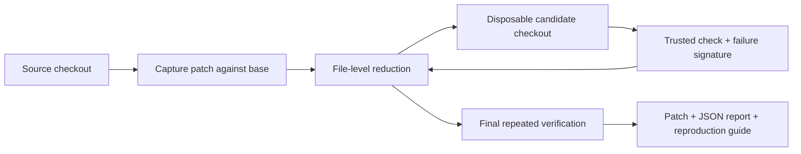

# Architecture

## Decision: executable core, thin adapters
Python 3.11+ standard library, Git, and a POSIX process environment. A CLI is sufficient to establish correctness; a later MCP adapter can call the same engine. An LLM-based reducer would add cost and variability without improving the first acceptance test. A browser app cannot run a local repository's checks directly.

## Ownership and contracts
- Engine: `src/reproslice/engine.py`, `tests/test_engine.py`. Owns capture, candidate isolation, command supervision, oracle, budgets, and reduction.
- Chief: package configuration, CLI, `tests/test_cli.py`, documentation, example, and skill. Owns artifact publication and presentation.
- Validator: independent read-only review and checks against integrated HEAD. Does not approve its own implementation.

Engine API: `minimize(repo: Path, base: str, check: str, signature: str, timeout: float = 30.0, max_checks: int = 100, repeats: int = 2) -> ReductionResult`. The result contains `patch: bytes` and a JSON-serializable `report: dict`; invalid inputs and untrustworthy reproduction raise `ReproSliceError`.

Report version 1 includes status, base commit, source fingerprint, check, signature, execution count, initial/kept/dropped paths, repeats, and timeout. Report status is `file_minimal` or `budget_exhausted`; exceptions are not success reports. The CLI adds artifact filenames.

## Failure oracle
The base must pass. The full patch must repeatedly fail with the configured signature. A candidate reproduces only when its normal nonzero exit and matching combined output occur on every required repetition. Timeout, excessive output, abnormal termination, and unrelated errors do not establish reproduction. A signature is an explicit practical identifier, not a proof of identical root cause.

## Isolation and persistence
Checks run in temporary candidate checkouts, not the source directory. This isolates repository files; it is not an OS or network sandbox. Only trusted commands and code should run. Checks can still reach credentials, services, absolute paths, and other processes permitted to the user. Source checkout contents and index must remain unchanged.

The CLI writes a new artifact directory outside the source checkout, publishing the complete set after successful reduction. There is no server, account, database, telemetry, or automatic upload. Artifacts record a command and file paths; review them before sharing.

## Reduction and guarantees
The first unit is a whole file's change, including additions and deletions. If every single remaining file-change deletion was checked and none reproduced, `file_minimal` means 1-minimal within that candidate set and oracle. It does not establish a globally smallest patch. A budget-exhausted result is verified but has no minimality claim. Finite checks cannot prove an arbitrary check is deterministic.

## Rollback
Use focused Git reverts for this implementation. Candidate workspace cleanup is limited to tool-created temporary paths. User originals and unrelated Git branches are never reset. No remote deployment or CI pipeline is part of this increment.
